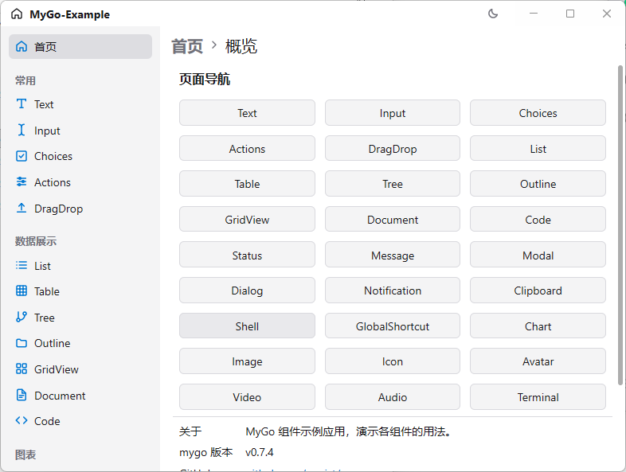
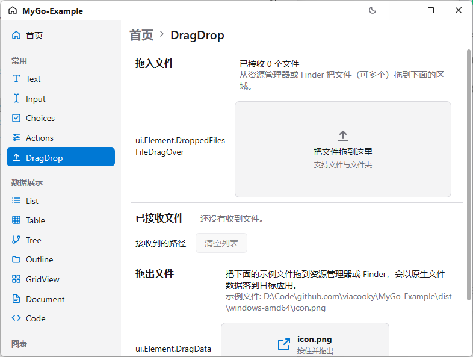
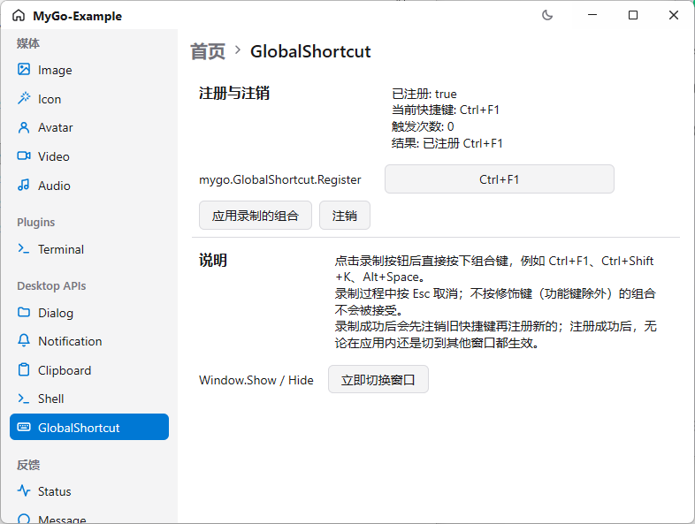
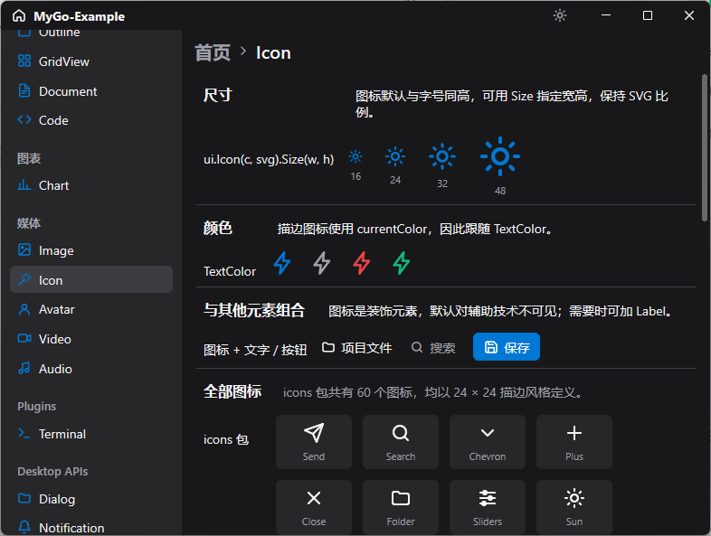

# MyGo-Example

[MyGo](https://github.com/egoist/mygo) 组件示例应用：用原生 UI 逐个演示 MyGo 的界面组件与桌面能力，并展示路由式多页面布局、自绘标题栏、暗黑模式与托盘。

目前只在 Windows 上测试验证，其他平台未测试。


## 截图







## 快速开始

环境要求：

- Go 1.27.3 及以上（版本见 `go.mod`）
- 本项目使用原生 UI，不需要 Bun、Node 或其他前端工具链

克隆并启动：

```sh
git clone https://github.com/viacooky/MyGo-Example.git MyGo-Example
cd MyGo-Example
go tool mygo dev
```

MyGo 作为 Go 工具依赖登记在 `go.mod` 的 `tool` 指令中，首次执行会自动下载，无需全局安装。

## 开发与构建

### 开发

开发模式带热重载，修改代码后窗口会重建：

```sh
go tool mygo dev
```

也可以直接运行入口包：

```sh
go run ./cmd/gui
```

- 入口 `cmd/gui/main.go` 只负责初始化 `slog` 并调用 `internal/app.Run()`；
- 窗口、托盘、路由、布局与页面都在 `internal/app`，其中 `app.go` 负责生命周期与托盘，`ui_layout.go` 负责标题栏、侧边栏与路由，`ui_page_*.go` 每个文件对应一个页面；
- 图标集中在 `internal/icons`（内嵌 SVG）；
- `mygo dev` 与 `go run` 的区别在于前者会按 `mygo.json` 注入开发环境信息并提供热重载。

提交前建议执行检查：

```sh
go build ./...
go vet ./...
go tool mygo vet .
```

其中 `go tool mygo vet .` 是 MyGo 专用检查，会覆盖 UI 生命周期与线程使用等框架相关规则。

调试使用 [`.vscode/launch.json`](.vscode/launch.json) 中的配置：

- `Debug my-app`：以 debug 模式启动 `cmd/gui`；
- `Attach to my-app`：附加到已运行的进程；
- `Debug view test`：以 test 模式调试 `internal/app`。

注意 `mygo dev` 的热重载会重启进程并断开调试会话。

### 构建

```sh
go tool mygo build
```

产物输出到 `mygo.json` 中 `out` 指定的目录（当前为 `dist/`）。应用名称、标识符、版本同样取自该文件，打包与分发时无需再改代码。

发布前可再用 `go tool mygo doctor` 检查项目配置。

### 发布

推送 `v*` 标签会触发 [`.github/workflows/release.yml`](.github/workflows/release.yml)：

1. 从标签去掉 `v` 后写回 `mygo.json` 的 `version`；
2. 在 Ubuntu 上安装 NSIS，执行 `go tool mygo build -platform windows/amd64`；
3. 自动生成变更日志并创建 GitHub Release，上传 `dist/windows-amd64/*-setup-*-amd64.exe`。

### 目录结构

```
MyGo-Example/
├── cmd/
│   └── gui/
│       └── main.go            程序入口，调用 internal/app.Run
├── internal/
│   ├── app/                   窗口、托盘、路由、布局与各页面
│   │   ├── app.go             应用生命周期、主窗口与托盘
│   │   ├── ui_layout.go       自绘标题栏、侧边栏与路由
│   │   └── ui_page_*.go       各示例页面
│   └── icons/                 内嵌的 SVG 图标
├── resources/
│   ├── icon.png               应用与托盘图标，随包分发
│   ├── audio-30s.mp3          Audio 页面示例
│   ├── audio-9s.wav           Audio 页面示例
│   ├── video_1080p_5s.mp4     Video 页面示例
│   └── video_1080p_10s.webm   Video 页面示例
├── third_party/
│   └── ghostty-vt/
│       └── ghostty-vt.dll     Terminal 插件依赖的原生库（Windows）
├── docs/                      README 截图
├── .github/
│   └── workflows/
│       └── release.yml        标签发布 Windows 安装包
├── .vscode/
│   └── launch.json            调试配置
├── mygo.json                  应用元数据与构建配置
├── go.mod
└── go.sum
```
